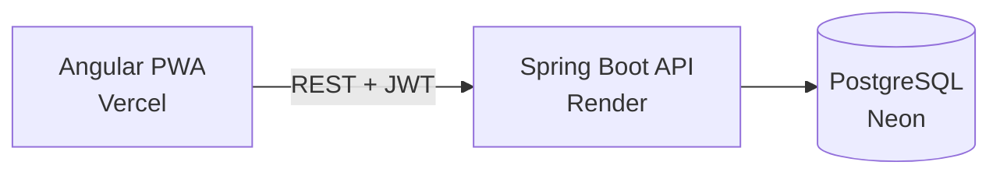
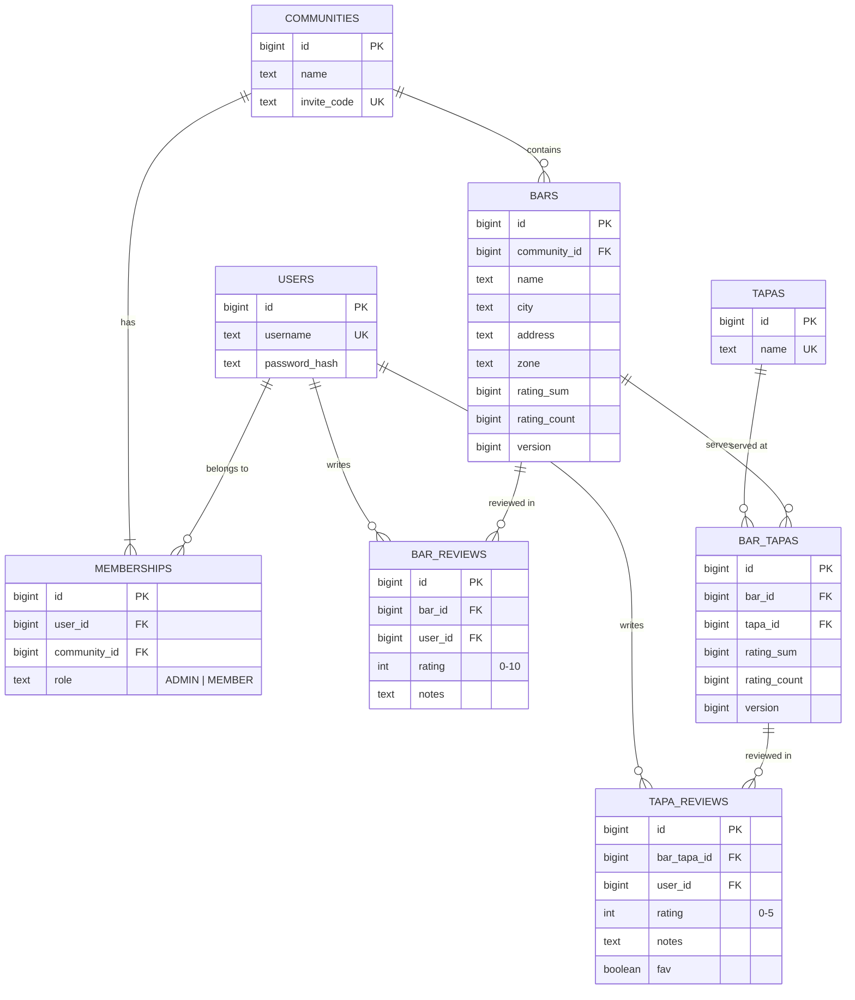

# La Ruta 🍺

A web app to save your group's favourite tapas bars, rate them together, and find in seconds which bar serves which tapa.

[](https://la-ruta-sigma.vercel.app)
[](https://github.com/idoceb00/la-ruta/actions/workflows/backend-ci.yml)


> The backend runs on Render's free plan and sleeps when idle, so the first load may take a moment while it wakes up.

## Why

With so many bars and tapas around, it's easy to forget what each place serves or what it was like.
When you're halfway through a night out and someone asks *"where did they serve morcilla?"*, La Ruta answers from your phone in a few seconds.

## Features

- **Communities:** private groups joined with an invite code. Each group has its own bars.
- **Bars and tapas:** any member can add and edit bars and the tapas they serve.
- **Reviews:** members rate bars and tapas with stars and notes; the app shows the group's average.
- **Search:** find a bar, or find every bar that serves a given tapa.
- **Installable:** works as a PWA on your phone.

## Architecture



### Data model



Every table also has audit columns (`created_at`, `updated_at`, `created_by`, `modified_by`).
A user has at most one review per bar and per bar tapa, and a tapa appears at most once per bar.

## Technical decisions

- **Community-scoped authorization.** Being logged in is not enough: every operation checks that the user belongs to the resource's community.
- **Concurrent ratings.** Averages are stored precomputed and protected with optimistic locking (`@Version`). Ratings retry automatically on conflict; bar edits don't, so the 409 reaches the user instead of silently overwriting another member's changes.
- **Flyway owns the schema.** Migrations are the single source of truth; Hibernate only validates.
- **Shared tapa catalog.** Tapas are added to a bar by name and reused across communities, which powers autocomplete and "where is X?" searches.
- **Cold starts handled in the UI.** A wake-up screen pings the backend before loading the app, instead of showing errors.
- **Agent-assisted development.** The repo includes an `AGENTS.md` with conventions and limits, plus commands to plan features and prepare commits.

## Testing

- **Backend:** integration tests run against a real PostgreSQL 17 through Testcontainers, not an in-memory database. They run in GitHub Actions with `./mvnw verify`.
- **Frontend:** unit tests with Vitest.

## Project structure

```
la-ruta/
├── backend/             Spring Boot REST API
├── frontend/            Angular PWA
├── AGENTS.md            Rules and conventions for coding agents
└── docker-compose.yml   Local PostgreSQL
```

## Running locally

Requirements: Java 21, Node with pnpm, and Docker.

```bash
cp .env.example .env        # then set JWT_SECRET (openssl rand -base64 32)
docker compose up -d        # PostgreSQL

cd backend
./mvnw spring-boot:run -Dspring-boot.run.profiles=dev   # Swagger UI at /swagger-ui.html

cd ../frontend
pnpm install
pnpm start                  # http://localhost:4200
```

## Roadmap

- [ ] Demo account, so anyone can try the app without registering
- [ ] Welcome screen for logged-out users
- [ ] Open Graph preview when sharing the link
- [ ] Accent-insensitive search